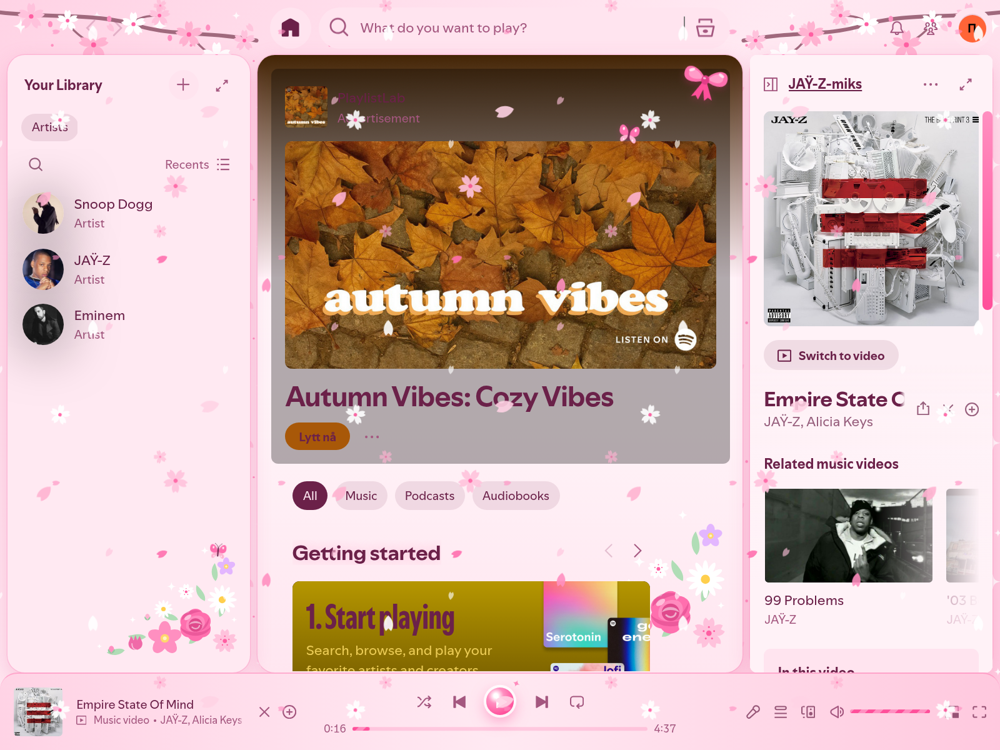
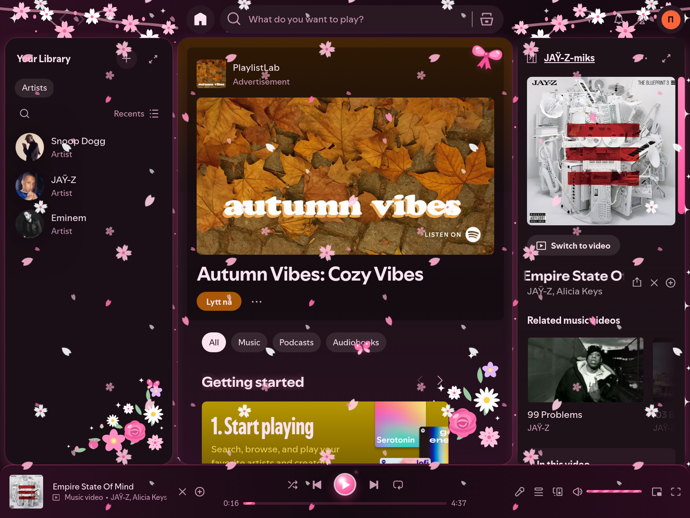

# Pinkly

A pastel-pink Spicetify theme with flowers, satin bows, fluttering butterflies,
glitter, sakura branches, a falling-petal "flower-fall", and shine 💅. The
decorations are inline SVGs in `user.css`, so no extra asset files or `theme.js`
are needed. Animations respect reduced-motion settings. To turn off the
flower-fall, set `--pinkly-flowerfall-opacity` to `0` in `user.css`.





## Install

**Spicetify Marketplace:** open Marketplace in Spotify, go to **Themes**, search for
**Pinkly**, and click **Install**. Choose `Pinkly` (light) or `Dark` as the color
scheme.

**Manually:** copy `user.css` and `color.ini` into a `Pinkly` folder inside
Spicetify's `Themes` directory (`spicetify path userdata` shows where it is), then
run:

```sh
spicetify config current_theme Pinkly color_scheme Pinkly   # or color_scheme Dark
spicetify apply
```

## Development

This is also a workspace for developing the theme. Edit `color.ini` for the
palette and `user.css` for styles. These are the files Spicetify consumes directly;
no CSS build step is needed.

## Requirements

- Node.js 22 or newer (24 is pinned in `.nvmrc`) and npm.
- Spotify **Desktop**, installed and opened at least once on the same machine.
- [Spicetify CLI](https://spicetify.app/docs/getting-started), installed as your
  normal user. The scripts find it on `PATH` or in the official installer's default
  location. Set `SPICETIFY_BIN` to an executable path for a custom installation.

The host can remain headless: the optional Docker desktop below provides XFCE,
Spotify, Spicetify, and a browser. Node dependencies and Spicetify CLI 2.46.3 are
also installed on the host; its standalone `setup`/`dev` commands require a local
Spotify Desktop installation. A browser mockup cannot reproduce Spotify's actual DOM.

## Boxed desktop on this host

Requires Docker with Compose. Start the desktop:

```sh
npm run desktop:up
```

This host is remote. Use T3's shared environment-port preview for port 6080 at
`/vnc.html?autoconnect=1&resize=remote`, or establish the SSH tunnel described below
before opening [the noVNC session](http://localhost:6080/vnc.html?autoconnect=1&resize=remote)
in a browser on your own computer. A bare localhost link alone does not reach the
remote host.

This builds a Debian XFCE desktop, installs the official Spotify client, applies
Pinkly, and starts Spicetify's live watcher. The first build downloads the desktop
and client packages. A Chromium browser is included for Spotify's login flow.
Sign in to Spotify yourself inside the desktop to test the full application.
The repository is mounted read-only; edits made here appear immediately inside
the container and trigger the theme watcher.

After signing in, run `spicetify enable-devtools` from `npm run desktop:shell` to
enable the Ctrl+Shift+I inspector shortcut. Spotify's login screen does not yet
have the cache file required by that command; live reload uses remote debugging
and works independently of the shortcut.

Port 6080 is bound to **127.0.0.1**. For a remote host, forward it over SSH, then
open the same localhost URL on your computer:

```sh
ssh -N -L 6080:127.0.0.1:6080 your-user@your-host
```

The session has no VNC password and is intended for localhost or an SSH tunnel;
keep the loopback port binding. Raw VNC and Spotify's debugging port are not
published. The browser and Spotify disable their Chromium sandboxes inside this
non-root development container; the container uses Docker's default isolation.

```sh
npm run desktop:status # Container health
npm run desktop:logs   # Desktop, Spotify, and watcher output
npm run desktop:shell  # Terminal inside the desktop's environment
npm run desktop:down  # Stop the desktop
```

The scripts use passwordless `sudo -n` for Docker if needed on this host. The named
Docker volume `pinkly-desktop_profile` preserves Spotify login and desktop settings
across stops. Removing that volume deletes the saved profile. Spotify's installed
files and backups are separate from your host installation. To use another port,
set `PINKLY_DESKTOP_PORT` before starting. The image currently targets Linux amd64.

## First-time setup

```sh
npm ci
npm run setup
npm run dev
```

`setup` links this repository as `Themes/Pinkly` beside your Spicetify config,
selects its `Pinkly` color scheme, enables CSS and color replacement, and runs
`spicetify backup apply enable-devtools`. This activates Pinkly and may restart
Spotify. An existing theme at that path is never overwritten. The link follows
edits in this checkout; rerun setup if you move the checkout.

`dev` runs `spicetify watch -s`, watching theme files and automatically reloading
Spotify on changes. It may restart Spotify with remote debugging enabled. Leave
the command running while editing; stop it with Ctrl+C. There is no web server.

## Commands

| Command                       | Purpose                                                                     |
| ----------------------------- | --------------------------------------------------------------------------- |
| `npm run doctor`              | Check the CLI, Spotify installation, preferences, and active theme.         |
| `npm run theme:link`          | Link the checkout without changing the active theme. Works without Spotify. |
| `npm run setup`               | Link, select, back up, apply the theme, and enable DevTools.                |
| `npm run dev`                 | Watch the active Pinkly theme and reload Spotify.                           |
| `npm run apply`               | Reapply Pinkly after configuration changes.                                 |
| `npm run check`               | Check formatting and script syntax; works without Spotify.                  |
| `npm run format`              | Format CSS, JavaScript, JSON, and Markdown.                                 |
| `npm run spicetify -- <args>` | Run any Spicetify CLI command.                                              |

## Editing the theme

`color.ini` contains two palettes: the light `[Pinkly]` default and `[Dark]`.
Set `PINKLY_COLOR_SCHEME=Dark` to choose the dark one:

```sh
PINKLY_COLOR_SCHEME=Dark npm run desktop:up   # Docker desktop (recreates the container)
PINKLY_COLOR_SCHEME=Dark npm run setup        # Native Spotify installation
```

Run the same command without the variable to switch back. Both palettes must
define the extra `backdrop-*`, `main-top`, `main-bottom`, `card-top`, and `shine`
keys used by the gradients in `user.css`.

In each palette, `button` becomes
`var(--spice-button)`, and its RGB components become
`var(--spice-rgb-button)`. Use these variables in `user.css`, including translucent
colors such as `rgba(var(--spice-rgb-button), 0.2)`.

Open Spotify DevTools with Ctrl+Shift+I on Linux/Windows or Cmd+Option+I on macOS
to inspect elements and try styles. Copy working changes back into `user.css`.
Spotify selectors can change after client updates. The desktop connection and
live CSS injection have been verified here; the full layout styling still needs
checking in a logged-in client.

Optional JavaScript can be added as `theme.js`; Spicetify's theme watcher supports
it. Enable injection with `npm run spicetify -- config inject_theme_js 1` and
reapply. The `assets/` directory currently holds the project icon. Custom Spotify
asset replacement is disabled by default; enable `overwrite_assets` only when
you intentionally want to replace client assets.

## Troubleshooting

If Spotify or `prefs` cannot be found, open Spotify first, initialize the CLI with
`npm run spicetify`, then set the actual paths:

```sh
npm run spicetify -- config spotify_path "/absolute/path/to/spotify"
npm run spicetify -- config prefs_path "/absolute/path/to/spotify/prefs"
npm run setup
```

Use the platform-specific paths in the
[installation guide](https://spicetify.app/docs/getting-started). If Spotify was
installed after this workspace was configured, its paths may need to be set
manually. Spotify updates may require `npm run spicetify -- backup apply` before
watching again.

To stop using Pinkly, select your previous theme and run `apply`, or restore the
unmodified Spotify client with `npm run spicetify -- restore`. The repository and
theme link remain available for later development.

References: [theme development](https://spicetify.app/docs/development/themes),
[CLI commands and flags](https://github.com/spicetify/cli/blob/v2.46.3/spicetify.go).
